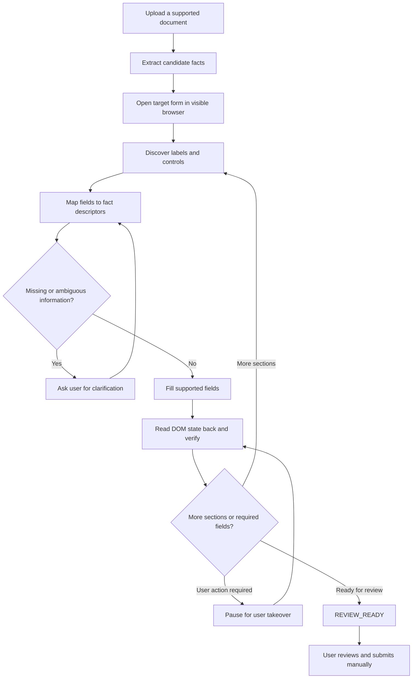
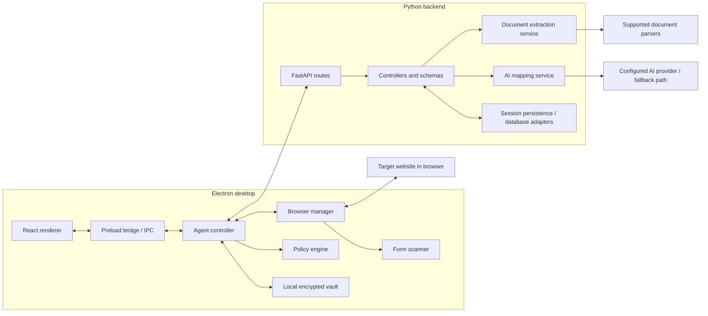

# AutoFiller AI

> **An AI-assisted desktop form-filling workflow with explicit human control at the point of submission.**

AutoFiller AI turns information in a user's documents into structured facts, maps those facts to fields on a target web form, fills supported controls, verifies the resulting DOM state, and pauses for human review before the final submission.

It is built as a desktop application with an Electron/React frontend, a Python FastAPI backend, Playwright browser automation, and AI-assisted field mapping. The central engineering principle is **assist with preparation, never take the final submission decision away from the user**.

[System specification & remediation notes](./autofiller%20V1.md) · [Real-form benchmark baseline](./BENCHMARK_V1.md) · [Agent development rules](./AGENTS.md)

---

## Contents

- [Why AutoFiller AI?](#why-autofiller-ai)
- [Product workflow](#product-workflow)
- [Features](#features)
- [Architecture](#architecture)
- [Repository map](#repository-map)
- [Technology stack](#technology-stack)
- [Safety, security and privacy](#safety-security-and-privacy)
- [Current status and limitations](#current-status-and-limitations)
- [Getting started on Windows](#getting-started-on-windows)
- [Configuration](#configuration)
- [Development commands](#development-commands)
- [Testing and CI](#testing-and-ci)
- [Build and packaging](#build-and-packaging)
- [Development conventions](#development-conventions)
- [Roadmap](#roadmap)

## Why AutoFiller AI?

Repeatedly completing applications, registrations, surveys, and other web forms can be slow and error-prone. The relevant information may already exist in a résumé, a document, or a locally maintained profile, but users still have to interpret each form and transfer that information field by field.

AutoFiller AI brings those steps into one guided workflow:

- Extract candidate facts from a supported document.
- Discover fields and labels on a target form.
- Match fields to available facts and ask the user when information is missing or ambiguous.
- Fill supported controls and verify what the browser actually accepted.
- Stop at a review-ready boundary so the user remains responsible for submission.

The goal is not blind browser clicking or a promise to support every website. It is a safer, observable workflow that combines automation with clear human handoff when the page, data, or permissions do not permit reliable progress.

## Product workflow



The intended lifecycle is:

1. **Upload and extract** — parse a supported document and produce candidate facts.
2. **Discover** — inspect the current page for eligible form controls and human-readable labels.
3. **Map** — use field metadata and available fact descriptors to select plausible matches.
4. **Clarify** — request missing or ambiguous information rather than silently inventing a value.
5. **Fill** — interact with supported native or custom controls through the browser.
6. **Verify** — read the page's state back and check that the intended interaction succeeded.
7. **Continue safely** — proceed through legitimate intermediate sections only when the policy and required-field checks permit it.
8. **Review** — enter `REVIEW_READY` and leave the final submission decision to the user.

## Features

### Document-to-fact workflow

- Document extraction through the FastAPI backend.
- Structured fact descriptors for matching form labels to candidate information.
- Support for the document formats explicitly accepted by the backend; consult the implementation and error messages for current format limits.
- Missing-information clarification rather than guessing when a required fact cannot be established.

### Browser and form automation

- Playwright-driven browser interaction.
- Discovery and handling of common native form controls.
- Role/ARIA-based custom control work for interfaces that render radios, checkboxes, or listbox-style controls as custom elements.
- Multi-section workflows with field-state verification and readiness checks.
- A user-takeover path for blocked, disabled, authenticated, unsupported, or otherwise unfillable controls.
- Option matching with normalization and a confidence threshold to avoid selecting an uncertain option.

> Website compatibility depends on the site's DOM, accessibility semantics, authentication state, dynamic behavior, and supported control patterns. Custom widgets that cannot be safely filled or verified should be left for the user.

### Desktop experience

The Electron desktop UI organizes the workflow, profile/fact handling, settings, help, progress, and session history. The renderer communicates with privileged Electron functionality through a controlled preload/IPC boundary rather than receiving unrestricted access to Node.js APIs.

### Session lifecycle

The application tracks progress and supports review and handoff states. A session that requires the user's attention must remain available while the user acts; cleanup should occur when a session is explicitly stopped, aborted, completed, or torn down according to its lifecycle rules.

## Architecture

AutoFiller AI separates the desktop experience, browser orchestration, and backend document/AI services.



### Component responsibilities

| Component | Responsibility |
|---|---|
| React renderer (`desktop/src/`) | Screens, user input, progress, clarification and session presentation. |
| Electron main process (`desktop/electron/`) | Privileged orchestration, browser lifecycle, IPC handlers and application services. |
| Preload bridge | Exposes the intentionally limited renderer-to-main-process API. |
| Agent controller | Coordinates extraction results, mapping, field filling, verification, user handoff and session state. |
| Browser manager | Owns Playwright browser/page readiness and interaction lifecycle. |
| Form scanner | Discovers eligible controls and their labels, required status and options. |
| Policy engine | Applies action and navigation restrictions, including the boundary around final submission. |
| Option matcher | Normalizes option text and scores candidate matches to reduce unsafe guessing. |
| Encrypted local vault | Holds locally managed sensitive facts using the application's vault workflow. |
| FastAPI backend (`backend/core/`) | API layer, request/response validation, document extraction, AI mapping and session-related services. |
| GitHub Actions | Runs backend, desktop, wire-contract, security and test checks on pushes and pull requests to `main`. |

This diagram is a conceptual view of the system boundaries; the source code remains authoritative for exact call paths and runtime behavior.

## Repository map

```text
autofiller/
├── .github/workflows/ci.yml      # GitHub Actions CI
├── AGENTS.md                     # Engineering, safety and agent workflow rules
├── BENCHMARK_V1.md               # Recorded initial benchmark and known gaps
├── autofiller V1.md              # Detailed system specification and audit notes
├── verify_security_live.py       # Live security verification checks
├── backend/
│   ├── main.py                   # Uvicorn/FastAPI entry point
│   ├── .env.example              # Backend developer configuration template
│   ├── requirements.txt          # Pinned Python dependencies
│   ├── commons/                  # Shared backend utilities
│   ├── core/
│   │   ├── apis/                 # FastAPI app and routes
│   │   ├── controllers/          # Request orchestration
│   │   ├── cruds/                # Data-access operations
│   │   ├── database/             # Database setup/adapters
│   │   ├── models/               # Domain and persistence models
│   │   └── services/             # Document and AI services
│   ├── scripts/                  # Contract and developer checks
│   └── tests/                    # Backend test suite
└── desktop/
    ├── package.json              # Scripts, dependencies and packaging config
    ├── electron/                 # Main process, browser, agent, IPC and policy
    ├── src/                      # React renderer and views
    ├── public/                   # Static assets
    └── tests/                    # Policy, scanner, vault and E2E tests
```

## Technology stack

| Area | Technologies |
|---|---|
| Desktop runtime | Electron 34 |
| UI | React 18.3, TypeScript 5.7, Vite, CSS |
| Browser automation | Playwright |
| Backend/API | Python 3.13, FastAPI, Uvicorn |
| Request and data models | Pydantic v2 |
| AI integration | Google GenAI SDK; optional fallback paths must be checked against the current configuration and implementation |
| Document processing | PyMuPDF and supported text/image parsing paths |
| Persistence/data access | MongoDB-related drivers and application session/data models |
| Desktop tests | Node-based test runners and Playwright Chromium |
| Backend tests | pytest and pytest-asyncio |
| CI and security checks | GitHub Actions, npm audit, pip-audit, Gitleaks, wire-contract checks and live security verification |

Exact dependency versions are pinned in `desktop/package.json`, `desktop/package-lock.json`, and `backend/requirements.txt`.

## Safety, security and privacy

Safety is a core product requirement, not an optional mode.

### Never-Submit boundary

- Automation is intended to stop at `REVIEW_READY`.
- Final submission remains a user action.
- Programmatic final-submit mechanisms have been removed from the documented implementation.
- Intermediate navigation is distinct from final submission and must remain subject to policy checks.
- Consent, declaration, payment, order, or submission actions must not be automatically triggered just to improve a fill-rate metric.

### Zero-value privacy contract

Field values are sensitive. The architecture is designed to send field descriptors—such as labels, types and confidence metadata—for AI-assisted matching rather than sending raw profile values for that matching step. The desktop can attach the selected fact value locally after receiving a mapping.

Sensitive values must not be included in renderer events, logs, session history, verification records, or backend audit persistence. Verification should retain safe metadata and outcome flags rather than raw expected/actual values.

**Important:** this does not mean all processing is offline. Uploaded documents may be processed by the configured external AI provider, and labels or other request metadata may leave the device. Review the provider configuration and its data-handling terms before using sensitive documents.

### Other security controls

- A controlled Electron preload/IPC boundary and restrictive desktop security configuration.
- No hardcoded API credentials; configure provider keys locally through ignored environment files.
- Backend document path-containment checks to restrict extraction to permitted locations.
- Explicit file-format handling and structured errors for unsupported or empty documents.
- Protocol/navigation restrictions and policy checks around sensitive actions.
- Regression tests for privacy contracts, API behavior and the Never-Submit boundary.

These safeguards reduce risk but do not make arbitrary websites safe or guarantee compatibility with every login, CAPTCHA, anti-bot, or custom-control flow. When authentication or user action is required, the intended behavior is a visible handoff—not bypassing the restriction.

## Current status and limitations

AutoFiller AI is an actively developed engineering project. The repository contains a desktop application, backend services, automated tests, CI, a detailed system specification, and an initial benchmark report. It should not be presented as universally compatible or production-certified for every website.

The committed benchmark document is an **initial baseline**, not proof of current universal performance:

- Its recorded real-web-form correct-fill rate is **0% (0/7 measured eligible fields)** for that baseline.
- Its controlled-fixture fill rate is recorded as **90% (35/39 fields)**.
- Its safe-stop rate is recorded as **100% (8/8 runs)**.
- Its honeypot suppression rate is recorded as **67% (2/3)**, identifying a gap at that time.

See [BENCHMARK_V1.md](./BENCHMARK_V1.md) for the methodology and caveats. Do not treat these historical baseline figures as current post-fix measurements.

Known constraints include:

- Forms requiring sign-in, verified accounts, CAPTCHA, or operator authorization may require user takeover.
- Custom controls are only safe to automate when they can be discovered, interacted with and verified reliably.
- Dynamic pages can change after scanning; readiness and verification checks are necessary.
- AI mappings are probabilistic and must be verified against the actual form state.
- External AI processing has provider-specific privacy implications.
- The final form submission is intentionally left to the user.

## Getting started on Windows

The following commands reflect the repository's current scripts and entry points. Run commands from the repository root unless the step says otherwise.

### Prerequisites

- Git
- Node.js 20 recommended (matches CI)
- Python 3.13 (matches CI)
- npm
- A supported browser/runtime environment for Playwright Chromium
- A Google Gemini API key for document/AI features that require it

### 1. Clone the repository

```powershell
git clone https://github.com/Aayush-Dubey123/autofiller.git
cd autofiller
```

### 2. Configure the backend

```powershell
cd backend
py -3.13 -m venv .venv
.\.venv\Scripts\Activate.ps1
python -m pip install --upgrade pip
pip install -r requirements.txt
Copy-Item .env.example .env
```

Open `backend/.env` and set `GEMINI_API_KEY` to your own key. The template also supports an optional `GEMINI_MODEL`. Never commit the populated `.env` file.

Start the backend from the `backend/` directory:

```powershell
python main.py
```

By default, `backend/main.py` starts the service on `127.0.0.1:8000` in development mode. `HOST` and `PORT` can override those defaults.

### 3. Install desktop dependencies

Open a second terminal at the repository root:

```powershell
cd desktop
npm ci
```

### 4. Run the desktop development UI

In the `desktop/` directory:

```powershell
npm run dev
```

This starts Vite for the renderer. For the full Electron application, use the project's Electron command after the backend is running:

```powershell
npm run electron
```

The Electron script builds the desktop app before launching it. For the complete desktop workflow, keep the backend process running in its own terminal.

> If your local working branch has newer setup changes than the default branch, follow the scripts and configuration in that checked-out revision. Do not copy API keys into issue reports, logs, screenshots, or commits.

## Configuration

The committed backend template currently documents:

| Variable | Purpose |
|---|---|
| `GEMINI_API_KEY` | API key used by the configured Gemini integration. |
| `GEMINI_MODEL` | Optional model override; the backend template documents a default when omitted. |
| `HOST` | Optional backend bind host; defaults to `127.0.0.1`. |
| `PORT` | Optional backend port; defaults to `8000`. |
| `ENV` | Controls development reload behavior in `backend/main.py`; defaults to `development`. |

The `HOST`, `PORT`, and `ENV` variables are read by the backend entry point; they are not listed in `backend/.env.example` at present. Inspect the current source for any additional provider-specific or desktop configuration before relying on an undocumented variable.

## Development commands

### Desktop

Run from `desktop/`:

| Command | Purpose |
|---|---|
| `npm ci` | Install the exact dependency tree from the lockfile. |
| `npm run dev` | Start the Vite renderer development server. |
| `npm run typecheck` | Type-check renderer and Electron TypeScript. |
| `npm run build` | Type-check and build renderer/Electron output. |
| `npm run test` | Build, then run PolicyEngine, ToolRegistry, scanner, vault and E2E tests. |
| `npm run electron` | Build and launch the Electron application. |
| `npm run pack` | Build a directory package using electron-builder. |
| `npm run dist` | Build distributable packages using electron-builder. |

### Backend

Run from `backend/` after activating the virtual environment:

```powershell
python -m pytest -v
python main.py
```

From the repository root, the wire-contract and live security checks are:

```powershell
python backend/scripts/check_wire_contract.py
python verify_security_live.py
```

The live security verification script exercises local security checks and may start its own test server. Use the intended development/test environment.

## Testing and CI

GitHub Actions runs on pushes and pull requests targeting `main`. The workflow has three jobs:

1. **Backend:** install Python 3.13 dependencies, run pytest, validate the wire contract, and run live security verification.
2. **Desktop:** install Node 20 dependencies, type-check and build, run policy/tool-registry/vault tests, install Playwright Chromium, and run scanner and agent E2E suites.
3. **Security:** run npm and Python dependency audits as non-blocking checks in the current workflow, plus a Gitleaks secret scan.

The desktop package's `npm run test` script builds first, so it takes longer than running a single targeted test. During development, prefer the test directly related to the changed component; run the complete suite at the agreed integration/commit checkpoint.

Example targeted checks from `desktop/`:

```powershell
node tests/policy_test.js
node tests/tool_registry_test.js
node tests/scanner_test.js
node tests/vault_test.js
node tests/e2e_integration_test.js
```

Run only the test relevant to your current change when iterating. The CI workflow is the source of truth for the exact checks required by the repository.

## Build and packaging

The desktop project uses electron-builder with the application ID `com.autofiller.ai` and product name `AutoFiller AI`. The checked-in configuration declares Windows NSIS installer and portable targets.

From `desktop/`:

```powershell
npm run pack
npm run dist
```

- `pack` creates an unpacked application directory under the configured output directory.
- `dist` creates distributable packages.
- Validate the generated artifacts on the target Windows environment before distributing them. A successful development build is not equivalent to a signed, production-certified release.

## Development conventions

Read [AGENTS.md](./AGENTS.md) before implementing changes. It defines the project's architecture, mandatory skill-selection workflow, testing expectations, and safety rules.

Core invariants:

- Never add a programmatic final-submit path.
- Do not weaken the PolicyEngine or bypass authentication.
- Do not log or persist raw personal field values.
- Do not lower test expectations to make a test pass.
- Keep changes small, inspect the existing implementation first, and run targeted tests during iteration.
- Preserve user work; inspect Git status before and after changes.
- Use relevant agent skills when available and report which skills were actually used.
- Do not claim tests, features, or security guarantees that were not verified.

## Roadmap

The roadmap is driven by measurable gaps, not feature claims:

- Improve reliable discovery and verification on unfamiliar real-world forms.
- Expand supported ARIA/custom-control patterns without relying on brittle class names or IDs.
- Improve dynamic section discovery, readiness handling, and human takeover/resume behavior.
- Increase honeypot suppression while avoiding false positives on legitimate controls.
- Measure post-fix results against the initial benchmark and report real-form and fixture results separately.
- Continue privacy, security and lifecycle regression testing.
- Evaluate a browser extension only after desktop reliability and safety metrics justify it.

---

## Project summary

AutoFiller AI is a human-in-the-loop form automation system that connects document extraction, AI-assisted field mapping, browser interaction, and DOM verification in a desktop application. Its defining constraint is that it can prepare a form, but **the user remains in control of the final submission**.
